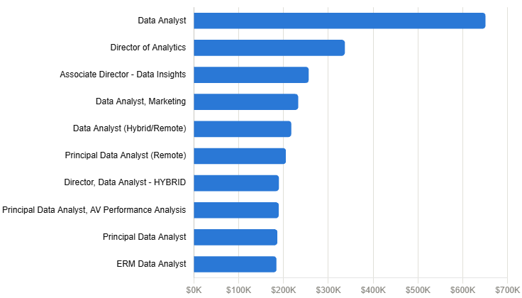
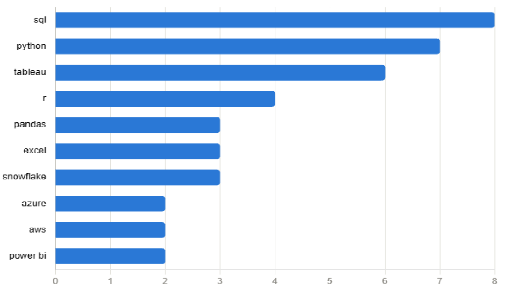

# Introduction
📊 Dive into the data job market! Focusing on data analyst roles, this project explores 💰top-paying jobs, 🔥 in-demand skills, and 📈 where high demand meets high salary in data analytics. 

🔍 SQL queries? CHeck them out here: [project_sql folder](/project_sql/)
# Background
Driven by a quest to navigate the data analyst job market more effectively, this project was born from a desire to pinpoint top-paid and in-demand skills, streamlining others work to find optimal jobs. 

Data hails from [SQL Course](https://www.lukebarousse.com/sql). It's packed with insights on job titles, salaries, locations, and essential skills. 

### The questions I wanted to answer though my SQL queries were: 
+
1. What are the top-paying data anlayst jobs? 
2. What skills are required for these top-paying jobs? 
3. What skills are most in demand for data analysts? 
4. Which skills are associated with higher salaries? 
5. What are the most optimal skills to learn? 

# Tools I Used
For my deep dive into the data analyst job market, I harnessed the power of several key tools: 
- **SQL**: The backbone of my analysis, allowing me to query the database and unearth critical insights. 
- **PostgreSQL**: The chosen database managemnt system, ideal for handling the job posting data. 
- **Visual Studio Code**: My go-to for database management and executing SQL queries. 
- **Git & GitHub**: Essential for version control and sharing my SQL scripts and analysis, ensuring collaboration and project tracking. 

# The Analysis
Each query for this project aimed at investigating specific aspects of the datea analyst job market. Here's how I approacehd each question: 

### 1. Top Paying Data Analyst Jobs
To identify the highest-paying roles, I filtered data analyst positions by average yearly salary and location, focusing on remote jobs. This query highlights the high paying opportunitiess in teh field.

```sql
SELECT
    job_id, 
    job_title, 
    job_location, 
    job_schedule_type, 
    salary_year_avg, 
    job_posted_date,
    name AS company_name
FROM
    job_postings_fact
LEFT JOIN company_dim ON job_postings_fact.company_id = company_dim.company_id
WHERE
    job_title_short = 'Data Analyst' AND 
    job_location = 'Anywhere' AND
    salary_year_avg IS NOT NULL
ORDER BY 
    salary_year_avg DESC
LIMIT 10
```
Here's the breakdown of the top data anlayst jobs in 2023: 
- **Wide Salary Range:** Top 10 paying data analyst roles span from $184,000 to $650,000, indicating significant salary potential in the field. 
- **Diverse Emplyoers:** Companies like SmartAsset, Meta, and AT&T are among those offering high salaries, showing a broad interest across different industries.
- **Job Title Variety:** There's a high diversity in job titles, from Data Analyst to Director of Analytics, reflecting varied roles and speciliazations within data analytics. 


*Bar gaph visualizing the salary for the top 10 salaries for data analysts; Claude generated this graph from my SQL query results*

### 2. Skills for Top Paying Jobs

To understand what skills are required for the top-paying jobs, I joined the job postings with the sklls data, providing insights into what employers value for high-compensation roles. 

```sql
WITH top_paying_jobs AS (
    SELECT
        job_id, 
        job_title, 
        salary_year_avg, 
        name AS company_name
    FROM
        job_postings_fact
    LEFT JOIN company_dim ON job_postings_fact.company_id = company_dim.company_id
    WHERE
        job_title_short = 'Data Analyst' AND 
        job_location = 'Anywhere' AND
        salary_year_avg IS NOT NULL
    ORDER BY 
        salary_year_avg DESC
    LIMIT 10
)

SELECT 
    top_paying_jobs.*, 
    skills
FROM top_paying_jobs
INNER JOIN skills_job_dim ON top_paying_jobs.job_id = skills_job_dim.job_id
INNER JOIN skills_dim ON skills_job_dim.skill_id = skills_dim.skill_id
ORDER BY salary_year_avg DESC
```
Here's the breakdown of the most demanded skills for the top 10 highest paying data analyst jobs in 2023: 
- **SQL** is leading with a bold count of 8
- **Python** follows closely with a bold count of 7.
- **Tableau** is also highly sought after, with a bold count of 6. Other skills like R, Snowflake, Pandas, and Exel show varying degress. 


*Bar gaph visualizing the count of skills for the top 10 paying jobs for data analysts; Claude generated this graph from my SQL query results*

### 3. In-Demand Skills for Data Analysts
This query helped identify the skills most frequently requested in job postings, directing focus to areas with high demand. 

```sql
SELECT 
    skills, 
    COUNT(skills_job_dim.job_id) AS demand_count 
FROM job_postings_fact
INNER JOIN skills_job_dim ON job_postings_fact.job_id = skills_job_dim.job_id
INNER JOIN skills_dim ON skills_job_dim.skill_id = skills_dim.skill_id
WHERE 
    job_title_short = 'Data Analyst'
    AND job_work_from_home = TRUE 
GROUP BY skills
ORDER BY demand_count DESC
LIMIT 5
```
Here's the breakdown of the most demanded skills for data analysts in 2023: 
- **SQL** and **Excel** remain fundamental, emphasizing the need for strong foundational skills in data processing and spreadsheet manipulation.
- **Programming** and **Visualization Tools** like **Python**, **Tableau**, and **Power BI** are essential, pointing towards the increasing importance of technical skills in data storytelling and decision support . 

| skills | demand_count |
|---|---|
| sql | 7291 |
| excel | 4611 |
| python | 4330 |
| tableau | 3745 |
| power bi | 2609 |

*Table of the demand for the top 5 skills in data analyst job postings*

### 4. Skills Based on Salary
Exploring the average salaries associated with different skills revealed which skills are the highest paying. 
```sql
SELECT 
    skills, 
    Round (AVG(salary_year_avg), 0) AS avg_salary
FROM job_postings_fact
INNER JOIN skills_job_dim ON job_postings_fact.job_id = skills_job_dim.job_id
INNER JOIN skills_dim ON skills_job_dim.skill_id = skills_dim.skill_id
WHERE job_title_short = 'Data Analyst' AND
    salary_year_avg IS NOT NULL
GROUP BY skills
ORDER BY avg_salary DESC
LIMIT 25
```
Here's a breakdown of the results for top paying skills for Data Analysts:

- **High Demand for Big Data & ML Skills:** Top salaries are commanded by analysts skilled in big data technologies (PySpark, Couchbase), machine learning tools (DataRobot, Jupyter), and Python librates (Pandas,NumPY), reflecting the industry's high valuation of data processing and predictive modeling capabilites. 
- **Software Development & Deployment Proficiency:** Knowledge in development and deployment tools(GitLab, Kubernetes, Airflow) indicates a lucrative crossover between data analysis and engineering, with a premium on skills that facilitate automation and efficient data pipeline management. 
- **Cloud Computing Experise:** Familiarity with cloud and data engineering tools (Elasticsearch, Databricks, GCP) underscores the growing importance of cloud-based analytics environments, suggesting that cloud proficiency significantly boosts earning potential in data analytics. 

| skills | avg_salary |
|---|---|
| pyspark | 208172 |
| bitbucket | 189155 |
| watson | 160515 |
| couchbase | 160515 |
| datarobot | 155486 |
| gitlab | 154500 |
| swift | 153750 |
| jupyter | 152777 |
| pandas | 151821 |
| elasticsearch | 145000 |

*Table of the average salary for the top 10 paying skills *

### 5. Most Optimal Skills to Learn

Combining insights from demand and salary data, this query aimed to pinpoint skills that are both in high demand and have high salaries, offering a stategic focus for skill development. 


```sql
WITH skills_demand AS (
    SELECT 
        skills_dim.skill_id,
        skills_dim.skills, 
        COUNT(skills_job_dim.job_id) AS demand_count 
    FROM job_postings_fact
    INNER JOIN skills_job_dim ON job_postings_fact.job_id = skills_job_dim.job_id
    INNER JOIN skills_dim ON skills_job_dim.skill_id = skills_dim.skill_id
    WHERE 
        job_title_short = 'Data Analyst' 
        AND salary_year_avg IS NOT NULL
        AND job_work_from_home = TRUE
    GROUP BY skills_dim.skill_id
), average_salary AS (
    SELECT 
        skills_job_dim.skill_id,
        Round (AVG(salary_year_avg), 0) AS avg_salary
    FROM job_postings_fact
    INNER JOIN skills_job_dim ON job_postings_fact.job_id = skills_job_dim.job_id
    INNER JOIN skills_dim ON skills_job_dim.skill_id = skills_dim.skill_id
    WHERE 
        job_title_short = 'Data Analyst' 
        AND salary_year_avg IS NOT NULL
        AND job_work_from_home = TRUE
    GROUP BY skills_job_dim.skill_id
)


SELECT
    skills_demand.skill_id,
    skills_demand.skillS,
    demand_count, 
    avg_salary
From    skills_demand
INNER JOIN average_salary ON skills_demand.skill_id = average_salary.skill_id
WHERE demand_count > 10
ORDER BY
    avg_salary DESC,
    demand_count DESC
```
| skill_id | skills | demand_count | avg_salary |
|---|---|---|---|
| 8 | go | 27 | 115320 |
| 234 | confluence | 11 | 114210 |
| 97 | hadoop | 22 | 113193 |
| 80 | snowflake | 37 | 112948 |
| 74 | azure | 34 | 111225 |
| 77 | bigquery | 13 | 109654 |
| 76 | aws | 32 | 108317 |
| 4 | java | 17 | 106906 |
| 194 | ssis | 12 | 106683 |
| 233 | jira | 20 | 104918 |

- **Cloud & big data platforms (Snowflake, Azure, AWS, BigQuery, Hadoop)** — This is the largest and most consistent group, with 5 of the 10 skills falling here. Demand ranges from 13–37 postings and salaries cluster tightly between $108K–$113K. This makes cloud/big-data infrastructure the strongest overall category to invest in: it offers the best balance of demand and pay, and is broad enough to apply across many employers rather than being tied to one company's specific stack.

- **Collaboration & project-management tools (Confluence, Jira)** — These pay well ($114,210 and $104,918) despite relatively low demand (11 and 20 postings). This suggests that when these tools do appear in a posting, it's often for more senior or cross-functional roles where the ability to work within structured, agile team environments is valued — not as standalone technical skills, but as a signal of process maturity.

- **Programming languages (Go, Java)** — Go leads the entire list in salary ($115,320) despite modest demand (27), while Java sits lower on both demand (17) and salary (106,906). This points to Go as a differentiating, less commonly required skill that pays a premium likely because fewer analysts have it, whereas Java — more common and generalized — commands a comparatively smaller premium.

# What I Learned
Throughout this adventrue, I've turbocharged my SQL toolkit with some seweous firepower: 
- **Complex Query Crafting** Mastered the art of advanced SQL, merging tables like a pro and wielding WITH clauses for ninja-level temp table maneuvers. 
- **Data Aggregations:** Got cozy with GROUP BY and turned aggregate functions like COUNT() and AVG() into my data-summarizing sidekicks. 
- **Analytical Wizardry:** Leveled up my real-world puzzle-solving skills, turning question into actionable, insightful SQL queries. 
### Conclusions
1. **Top-Paying Data Analyst Jobs:** The highest-paying jobs for data analysts that allow remote work offer a wide range of salaries, the highest at $650,000!
2. **Skills for Top-Paying Jobs:** High-paying data analyst jobs require advanced proficiency in SQL, suggesting it's a critical skill for earning a top salary.
3. **Most In-Demand Skills:** SQL is also the most demanded skill in the data analyst job market, ths making it essential for job seekers. 
4. **Skills with Higher Salaries:** Specialized skills, such as SVN and Solidity, are associated with the highest average salaries, indicating a premium on niche expertise
5. **Optimal Skills for Job Market Value:** SQL leads in demand and offers for a high average salary, positioning it as one of the most optimal skills for data analysts to learn to maximize thier market value. 

### Closing Thoughts
This project enhanced my SQL skills and provided valuable insights into the data analyst job market. The findings from the analysis serve as a guide to prioritizing skill development and job search efforts. Aspiring data analysts can better position themselves in a compettive job market by focusing on high-demand, high-salary skills. This exploration highlights the importance of continuous learning and adaptation to emerging trends in the field of data analytics. 